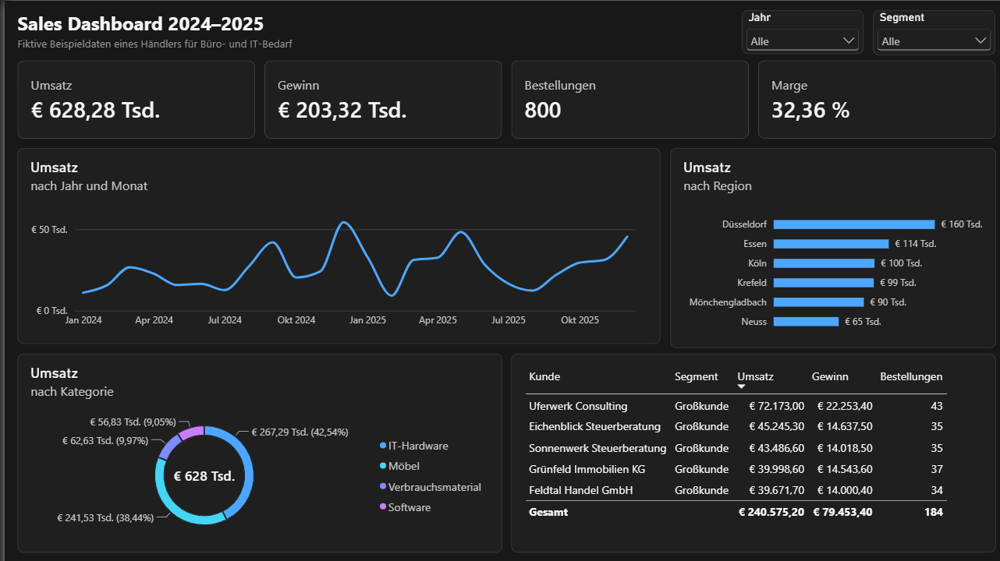
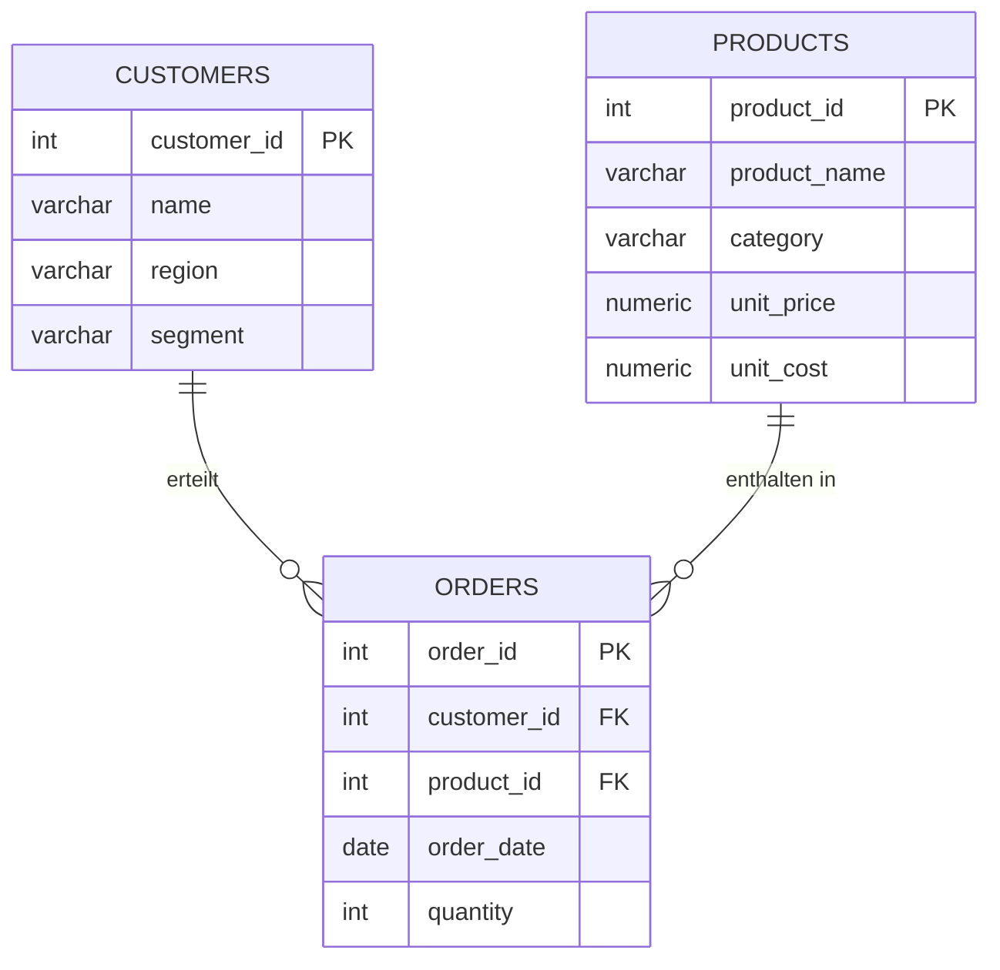

# Sales Analytics Dashboard

Analyse der Verkaufsdaten eines Händlers für Büro- und IT-Bedarf mit **PostgreSQL**, **SQL**, **Excel** und **Power BI**.

> **Hinweis:** Alle Daten sind fiktiv. Kunden, Produkte und Bestellungen wurden für dieses Übungsprojekt erzeugt.



## Fragestellung

- Wie hoch sind Umsatz, Gewinn und Marge?
- Welche Regionen, Produktkategorien und Kunden sind am wichtigsten?
- Wie entwickelt sich der Umsatz über die Zeit?

## Tech-Stack

| Werkzeug | Wofür |
|---|---|
| PostgreSQL + DBeaver | Datenbank anlegen und Daten speichern |
| SQL | Daten verknüpfen und auswerten (JOIN, GROUP BY, Aggregatfunktionen) |
| Excel | Gleiche Auswertung mit XVERWEIS und Pivot-Tabellen |
| Power BI | Interaktives Dashboard mit Filtern, berechneten Spalten und DAX-Measures |

## Datenmodell

Drei Tabellen, verbunden über Fremdschlüssel. Ein Kunde kann viele Bestellungen haben, jede Bestellung gehört zu genau einem Kunden und enthält genau ein Produkt.



**Umfang:** 50 Kunden, 18 Produkte, 800 Bestellungen (Januar 2024 bis Dezember 2025)

## Vorgehen

1. **Datenbank:** Tabellen in PostgreSQL angelegt und Daten eingespielt (`sql/01_create_tables.sql`, `sql/02_insert_data.sql`)
2. **SQL-Analyse:** Umsatz und Gewinn pro Region, Kategorie, Kunde und Monat berechnet (`sql/03_analysis.sql`)
3. **Excel:** Dieselben Werte mit XVERWEIS zusammengeführt und mit einer Pivot-Tabelle ausgewertet (`excel/sales_analyse.xlsx`)
4. **Power BI:** Direkt mit PostgreSQL verbunden, Spalten `revenue` und `profit` sowie die Measures `Marge` und `Bestellungen` mit DAX angelegt und das Dashboard gebaut (`powerbi/Sales-Dashboard.pbix`)

**Beispiel SQL:** Umsatz pro Region

```sql
SELECT c.region,
       SUM(o.quantity * p.unit_price) AS umsatz
FROM orders o
JOIN customers c ON o.customer_id = c.customer_id
JOIN products p  ON o.product_id  = p.product_id
GROUP BY c.region
ORDER BY umsatz DESC;
```

**Beispiel DAX:** Marge

```
Marge = DIVIDE(SUM('public orders'[profit]), SUM('public orders'[revenue]))
```

## Ergebnisse

| Kennzahl | Wert |
|---|---|
| Umsatz | 628.284,50 € |
| Gewinn | 203.316,10 € |
| Marge | 32,4 % |
| Bestellungen | 800 |

- **Düsseldorf** ist die umsatzstärkste Region (ca. 160.000 €, rund ein Viertel des Umsatzes).
- **IT-Hardware** bringt den meisten Umsatz, **Möbel** aber den meisten Gewinn. IT-Hardware hat mit 26,8 % die niedrigste Marge, Möbel liegt bei 34,9 %.
- **Die Top 5 Kunden** sind alle Großkunden und machen zusammen rund 38 % des Umsatzes aus. Das zeigt eine hohe Abhängigkeit von wenigen Kunden.
- **Der Umsatz ist 2025 um etwa 17 % gestiegen.** Die stärksten Monate liegen jeweils im Dezember.

## Projekt starten

1. PostgreSQL und DBeaver installieren
2. `sql/01_create_tables.sql` und danach `sql/02_insert_data.sql` ausführen
3. `powerbi/Sales-Dashboard.pbix` mit Power BI Desktop öffnen und bei Bedarf die Verbindung zu `localhost` / Datenbank `postgres` anpassen

## Projektstruktur

```
├── data/        Rohdaten als CSV
├── sql/         Tabellen, Daten und Analyse-Abfragen
├── excel/       Auswertung mit XVERWEIS und Pivot-Tabelle
└── powerbi/     Dashboard-Datei und Screenshot
```

## Was ich gelernt habe

- SQL-Abfragen von der Frage her aufbauen: erst überlegen, was rauskommen soll, dann Tabellen, Filter und Gruppierung wählen
- Tabellen über Primär- und Fremdschlüssel verbinden, in SQL mit JOIN, in Excel mit XVERWEIS und in Power BI über Beziehungen
- Dass Umsatz und Gewinn zu unterschiedlichen Ergebnissen führen können
- Ein Dashboard so aufbauen, dass die wichtigsten Zahlen zuerst sichtbar sind

## Mögliche Erweiterungen

- Vergleich mit dem Vorjahr direkt in den Kennzahlen
- Zweite Seite mit Analyse nach Produkten
- Automatische Datenaktualisierung
